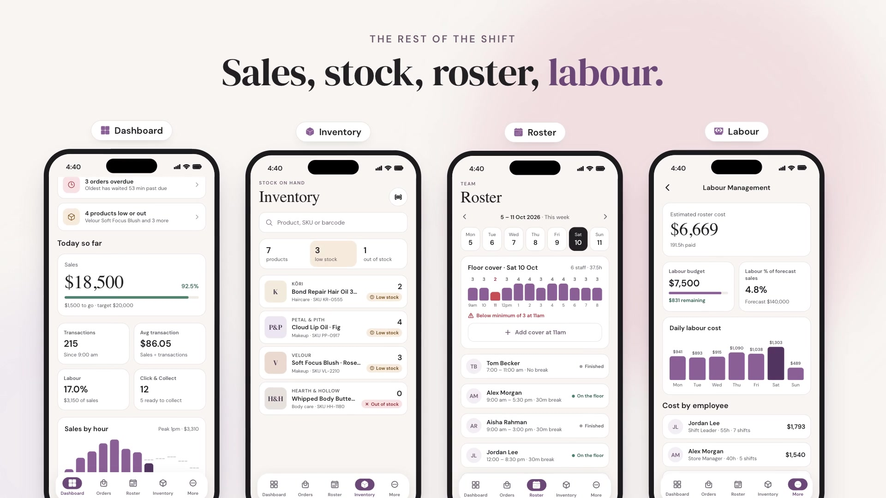

# Glowdesk

A mobile store-operations app for beauty retail teams: Click & Collect picking with barcode checks, inventory, weekly
roster, labour cost and an offline queue that syncs when the connection returns.

Independent portfolio project. All stores, staff, customers and products are fictional, and data comes from an in-app
mock server.

## Demo

[](docs/media/glowdesk-demo.mp4)

A 25-second walkthrough built from the app's real screens, copy and demo data. An overdue Click & Collect order is
checked unit by unit, a wrong product is turned away, picking carries on with no signal, and the order is marked ready
once the changes sync. It ends with the dashboard, inventory, roster and labour screens.

Select the image to download the video (MP4, 8 MB).

## Libraries

- Expo + Expo Router, React Native, TypeScript
- TanStack Query — server data, cache and offline queue
- Zustand + expo-sqlite — device state
- React Hook Form + Zod — forms and validation
- expo-camera — barcode scanning
- NetInfo — online state
- Jest + React Native Testing Library — tests
- ESLint, Prettier, cspell, knip, husky — quality gates

## Getting started

```bash
npm install
npx expo start
npm run check   # format, lint, typecheck, spelling, knip, tests
```

Demo sign-in: `RO1001` / `1111` (Store Manager) or `RO1002` / `2222` (Shift Leader).

## Docs

- [Architecture](docs/architecture.md)
- [Coding standards](docs/coding-standards.md)
- [Learnings](learnings/README.md)
